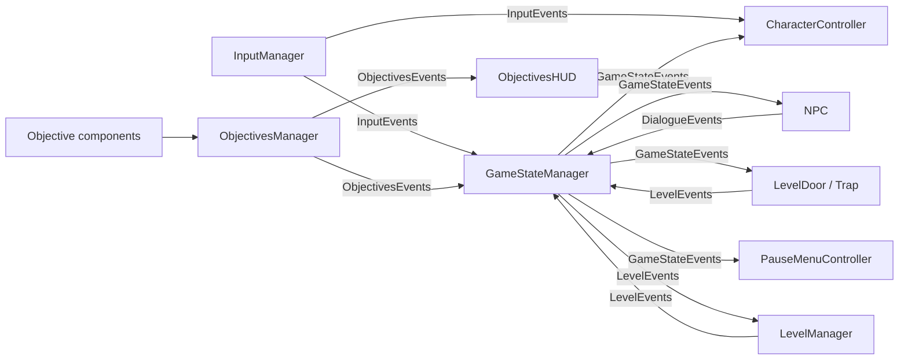

[README.md](https://github.com/user-attachments/files/33397034/README.md)
GameDev Assignment 3 — 2D Puzzle Platformer


A 2D puzzle platformer built in Unity 6. You play the **Little Traveler**, working through three cave levels where every exit door is sealed until the level's objectives are met: buttons to hold down, mazes to cross, traps to avoid and a clock to beat.

The project is built around a data-driven game state machine, a composable objective system and static event channels, so that levels are assembled in the editor rather than hard-coded.

## Table of Contents

- [Gameplay](#gameplay)
- [Controls](#controls)
- [Getting Started](#getting-started)
- [Architecture](#architecture)
- [Project Structure](#project-structure)
- [Adding a New Level](#adding-a-new-level)
- [Tech Stack](#tech-stack)
- [Third-Party Assets](#third-party-assets)
- [Authors](#authors)

## Gameplay

Each level starts with an NPC who explains the challenge. Complete every mandatory objective to open the final door, then walk through it to move on. Touching a trap or failing an objective restarts the level.

| Level | NPC | Challenge |
| --- | --- | --- |
| **Level 1** | Snufkin | A riddle: four buttons stand in a row, but only three open the door. Push weights onto the right ones. |
| **Level 2** | Flying King | Find the button hidden inside a trapped maze, with a 120-second timer running. |
| **Level 3** | Dark Knight | A 90-second run through traps, with buttons that open and close doors along the way. |

**Features**

- Physics-based movement with running, jumping and pushing objects
- Pressure buttons that can be held by the player or by pushable objects
- Timed objectives with a live HUD countdown
- Objective counter HUD (`Objectives: 2 / 3`)
- NPC dialogue with a typewriter effect and Skip / Next / Close
- Pause menu with Continue, Restart and Back to Menu
- Automatic level progression, returning to the main menu after the last level
- Camera follow with Cinemachine

## Controls

| Action | Keyboard | Gamepad |
| --- | --- | --- |
| Move | `A` / `D` or `←` / `→` | Left stick |
| Jump | `Space` | South button (A / Cross) |
| Pause | `Esc` | Select |
| Advance dialogue | On-screen button (mouse) | — |

## Getting Started

### Prerequisites

- [Unity Hub](https://unity.com/download)
- Unity Editor **6000.3.20f1** (Unity 6.3) — other versions may trigger a project upgrade
- Git

### Installation

```bash
git clone https://github.com/ShlomiGanon/GameDev-Assignment-3.git
```

1. Open Unity Hub and choose **Add → Add project from disk**.
2. Select the cloned folder and open it with Unity `6000.3.20f1`.
3. Wait for Unity to import the assets and resolve packages.

### Running the Game

1. Open `Assets/Scenes/MainScenes/MainMenu.unity`.
2. Press **Play**.

Start from the main menu when possible, since that is the first scene in the build order.

### Building

Open **File → Build Profiles**, pick a target platform and click **Build**. The scenes are already registered in this order:

1. `MainMenu`
2. `Level1`
3. `Level2`
4. `Level3`

## Architecture

Systems never reference each other directly. They communicate through static event channels, and a single persistent `Managers` object (singleton, `DontDestroyOnLoad`) carries the managers across scene loads.



### Game State Machine

`GameStateManager` runs a finite state machine that is assembled in the editor from components:

- **`GameState`** — a state. Each one points to a `StateSO` asset that declares the rules in force while it is active.
- **`TransitionBase`** — a child component of a state that answers `ShouldTransition()` and names a target state. The manager polls the active state's transitions every frame.
- **`StateSO`** — a ScriptableObject holding four flags that the rest of the game reacts to:

| Flag | Consumed by | Effect |
| --- | --- | --- |
| `CanMove` | `CharacterController` | Enables or disables player control |
| `ShowMenu` | `PauseMenuController` | Shows the pause menu and freezes time |
| `CanOpenFinalGate` | `LevelDoor` | Opens or closes the exit door |
| `CanDialogue` | `NPC` | Allows a dialogue to start |

On entering a state, the manager broadcasts its `StateSO` through `GameStateEvents.StateUpdated`, and each listener updates itself. Adding a new rule means adding a flag and a listener, with no changes to the state machine.

Available transitions:

| Transition | Fires when |
| --- | --- |
| `ButtonPressedTransition` | A UI button (Start, Resume, Restart, BackToMenu) is pressed |
| `PausePressedTransition` | Pause is pressed outside a menu scene |
| `DialogueTransition` | A dialogue starts or ends |
| `ObjectivesStatusChangedTransition` | All mandatory objectives become complete, or stop being complete |
| `FinishLineTriggerTransition` | The player walks through the open exit door |
| `HasNextLevelTransition` / `HasNoNextLevelTransition` | `LevelManager` reports whether another level follows |
| `FailedStateTransition` | The level is failed |
| `RestartedLevelTransition` | The level has finished reloading |
| `EpsilonTransition` | Immediately, with no condition |

### Objective System

- **`Objective`** — base class with `Complete`, `Uncomplete` and `Fail` states. Exposes both C# events and inspector `UnityEvent`s. Can be marked optional, or set to fail permanently once it is lost.
- **`ButtonObjective`** — complete while something is standing on it. Can be restricted to a single allowed interactor.
- **`TimerObjective`** — flips its completion state after a configurable duration and emits tick events for the HUD.
- **`ObjectiveSet`** — a composite objective that tracks other objectives, with filtering for all, mandatory-only or optional-only.

`ObjectivesManager` collects every `Objective` in a scene when it loads, wraps the mandatory ones in an `ObjectiveSet`, and reports progress, completion and failure through `ObjectivesEvents` and `LevelEvents`. Levels need no manual registration.

### Level Flow

`LevelManager` holds an ordered list of `LevelSO` assets. When the player reaches the exit, the state machine asks it whether a next level exists; it then either loads that scene or lets the game finish and return to the main menu. Restarts are handled the same way through `LevelEvents`.

### Data-Driven Content

| ScriptableObject | Purpose |
| --- | --- |
| `CharacterSO` | Character name, move speed, jump force, health |
| `NPCDialogue` | NPC name, portrait, dialogue lines, typing speed |
| `LevelSO` | Level name and scene name |
| `StateSO` | Rule flags for a game state |

## Project Structure

```text
Assets/
├── Animations/          Player animator and clips (Idle, Run, Jump, Fall, Push, Win)
├── Audio-Music/         Background music
├── BackGrounds/         Menu and cave backgrounds
├── Fonts & Materials/   Fonts and TextMesh Pro font assets
├── Pefabs/              Player, NPC, camera, HUD, menus, level objects, managers
├── PhysicsMaterials/    2D physics materials
├── Scenes/MainScenes/   MainMenu, Level1, Level2, Level3
├── ScriptableObject/    Level, NPC, player and state data assets
├── Scripts/
│   ├── Character/       Movement, animation, health, controller
│   ├── Environment/     Level door, pressure plate
│   ├── Events/          Dialogue and objective event channels
│   ├── Input/           Input System wrapper and input events
│   ├── Levels/          Traps, fail triggers, door switches
│   ├── Managers/        Game state machine, level manager, objectives manager
│   ├── NPC/             NPC dialogue behaviour
│   ├── Objective/       Objective, button, timer and set objectives
│   ├── SO/              ScriptableObject definitions
│   └── UI/              HUD, main menu, pause menu
├── Sprites/             UI buttons, doors, push buttons, NPC sprites
└── TileMap/             Cave and mossy tilesets and tile palettes
```

## Adding a New Level

1. Create a scene in `Assets/Scenes/MainScenes/` and add it to the build's scene list.
2. Create a `LevelSO` (**Create → Scriptable Objects → LevelSO**) and set its **Scene Name** to match the scene exactly.
3. Add the `LevelSO` to the `LevelManager` list on the `Managers` prefab, in play order.
4. Drop in the `Managers`, `Player`, `CinemachineCamera`, `HUD Canvas` and `PauseMenu (Canvas)` prefabs.
5. Place a `LevelDoor` and any objectives (`ObjectiveButton`, `TimerObjective`). They are discovered automatically.
6. Optionally add an `NPC` prefab with its own `NPCDialogue` asset (**Create → Dialogue → NPC Dialogue**).

Tags used by gameplay scripts: `Player`, `Ground`, `Pushable`, `PushButton`.

## Tech Stack

| | |
| --- | --- |
| Engine | Unity 6000.3.20f1 |
| Language | C# |
| Rendering | Universal Render Pipeline 17.3.0 (2D) |
| Input | Input System 1.19.0 |
| Camera | Cinemachine 3.1.7 |
| UI | uGUI 2.0.0 and TextMesh Pro |
| Level design | 2D Tilemap and Tilemap Extras 6.0.2 |

## Third-Party Assets

This project uses third-party art, fonts and audio, which remain the property of their respective creators:

- **Sprites:** Tasty Characters pack
- **Tilesets:** Mossy Tileset, Assets 1024 Cave
- **Fonts:** Baloo 2, Haedus, InkVerse, Diffusion
- **Music:** "Moonspire"

## Authors

- **Maor Buchbut**
- **Shlomi Ganon** — [@ShlomiGanon](https://github.com/ShlomiGanon)

Developed as a Game Development course assignment.
